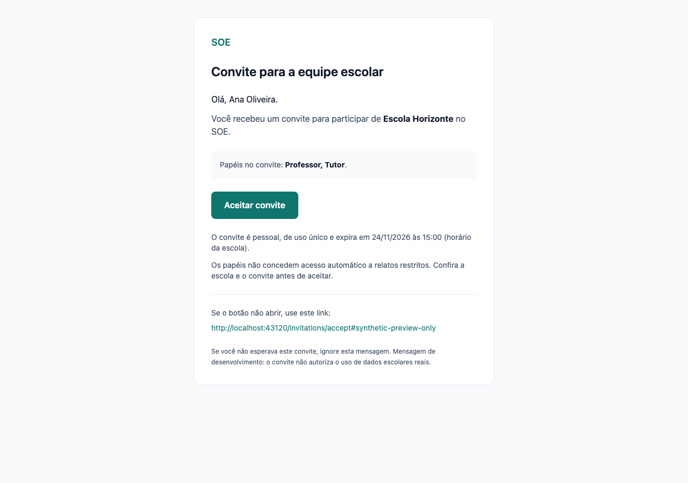
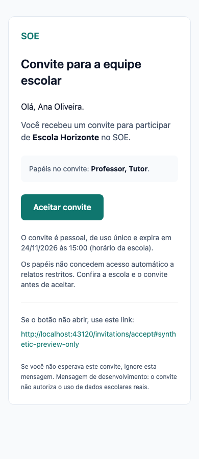

# QA parcial — convites e adoção do protocolo

**Gate: BLOQUEADO para validação completa da etapa.** Este registro preserva
testes parciais e formaliza o protocolo obrigatório pedido pelo responsável
pelo produto. Não representa conclusão da issue #6.

## Contexto

- Issue: https://github.com/LuisCarlos-git/soe-saas/issues/6.
- Plano: https://github.com/LuisCarlos-git/soe-saas/issues/6#issuecomment-7064210758.
- Fontes: PRD 1.3 RF01/RF09 e seções 6/7/16, decisões do domínio,
  ADR 0003, DESIGN.md e critérios de aceite da issue.
- Execução complementar: 21/11/2026, aproximadamente 14:39 UTC.
- Branch: `feat/staff-invitations`.
- Base: `d86641918c57f1725e6a753176b314e040c9a6e7`.
- **Aplicação em WIP:** alterações de API, migrations, contratos e pacote
  de e-mail ainda não commitadas. O commit deste relatório contém somente
  protocolo/evidência, não a implementação completa testada. Consulte o
  manifesto para os hashes dos arquivos fonte relevantes à execução.
- PostgreSQL e Mailpit temporários via Testcontainers; nenhuma entrega de
  e-mail externa. Dados de teste sintéticos `example.test`.
- Origem da mídia: HTML real do renderer React Email renderizado no Chromium
  via Playwright, anteriormente inspecionado em 21/11/2026. As capturas não
  foram feitas pela extensão Chrome e não mostram a jornada de aceite no app.

## Resultados observados

| ID          | Escopo executado                                     | Esperado e observado                                                                                                   | Status                        | Prova                                                                 |
| ----------- | ---------------------------------------------------- | ---------------------------------------------------------------------------------------------------------------------- | ----------------------------- | --------------------------------------------------------------------- |
| QA-006-01-A | Renderer do e-mail                                   | HTML/texto com nome, escola, papéis, validade e link; escape de HTML, assunto sem CR/LF e rejeição de URLs inadequadas | APROVADO no teste unitário    | [Log: 6 testes](email-unit.log)                                       |
| QA-006-01-B | Envio HTTP real                                      | Admin envia convite com papel TEACHER, API retorna 201, Mailpit recebe HTML/texto e listagem registra SENT             | APROVADO nesta jornada        | [Log de integração](invitations-integration.log) e manifesto do teste |
| QA-006-02-A | Cadastro/aceite/reuso pelo HTTP                      | Preview 200, cadastro/login/aceite 204, vínculo retornado somente para a escola convidante; repetir aceite retorna 410 | APROVADO nesta jornada        | Mesmo teste de integração, sem captura de token/cookie                |
| QA-006-02-B | Saneamento de logs                                   | Asserção de ausência do token usado e de dados sensíveis esperados no log capturado                                    | APROVADO no cenário executado | Mesmo teste; sentinelas e logs brutos não publicados                  |
| QA-006-05-A | Aparência do e-mail                                  | Layout, hierarquia, CTA, validade e link alternativo legíveis; sem overflow horizontal em 1280×900 e 390×900           | APROVADO somente no Chromium  | Prints abaixo e revisão visual independente                           |
| QA-006-03   | Expiração, revogação, conta diferente e concorrência | Ausência de vínculo/privilégio indevido                                                                                | NÃO EXECUTADO neste ciclo     | Pendente                                                              |
| QA-006-04   | Isolamento entre duas escolas e permissões restritas | Autorização no servidor e ausência de propagação de permissões                                                         | NÃO EXECUTADO neste ciclo     | Pendente                                                              |
| QA-006-05-B | UI do app pela extensão Chrome                       | Percurso visível de convite/aceite, validação de estados, teclado, reload e mobile                                     | BLOQUEADO                     | Nenhuma ferramenta Chrome conectada; UI ainda em implementação        |
| QA-006-06   | Clique duplo, duas abas e recuperação de rede na UI  | Efeito único e estado recuperável                                                                                      | NÃO EXECUTADO                 | Pendente de implementação e browser                                   |
| QA-006-GIF  | Gravação de interação                                | GIF real revisado do início ao resultado                                                                               | BLOQUEADO                     | Extensão não conectada; nenhum GIF produzido                          |

O teste de integração é uma única jornada com múltiplas asserções. Ele não
prova todos os critérios de segurança ou todos os cenários da issue. A recusa
de uma rota administrativa para o novo profissional não distingue, isoladamente,
bloqueio por MFA de bloqueio por papel. Essa cobertura continua pendente.
SENT significa aceitação pelo SMTP local, não leitura pelo destinatário.

## Prints revisados

Capturas com dados sintéticos e link inoperante `synthetic-preview-only`;
nenhum token de convite válido ou credencial aparece nos arquivos.

Os PNGs são fullPage; o desktop tem viewport 1280×900 e o celular 390×900.
Não foi constatado defeito material na revisão visual dessas duas capturas.
Gmail, Outlook, dispositivos físicos e animações não foram validados.

## Checks deste ciclo

| Comando                                                                                                                                             | Resultado                                               |
| --------------------------------------------------------------------------------------------------------------------------------------------------- | ------------------------------------------------------- |
| `pnpm exec vitest run packages/email/src/email.test.ts`                                                                                             | Exit 0; 6 testes aprovados                              |
| `node --experimental-vm-modules node_modules/jest/bin/jest.js --config jest.integration.config.cjs --runInBand apps/api/tests/invitations.test.mjs` | Exit 0; 1 jornada aprovada com PostgreSQL/Mailpit reais |

Logs publicados contêm apenas resumo de execução e aviso técnico, sem bodies,
headers, tokens ou conteúdo autenticador do e-mail. O HTML bruto do e-mail e
dados privados do navegador não integram esta evidência pública.

## Protocolo e próxima ação

A skill `qa-browser-evidence` foi instalada e referenciada no AGENTS.md.
Ela exige plano antes da etapa, QA com exploração plausível de UI/API,
evidência saneada no GitHub e checkpoint antes de avançar, abrir PR ou concluir.
Uma avaliação independente de uso confirmou o tratamento de Chrome ausente,
HTTP 200 insuficiente, WIP, publicação pública e GIF pendente.

Para liberar a jornada de navegador, conectar `@Chrome` nesta conversa e
confirmar ferramentas de captura/gravação. Em seguida, executar os cenários
pendentes conforme o plano e publicar o reteste com prints e GIFs reais.
Nenhum critério de aceite foi marcado e a issue permanece aberta.
